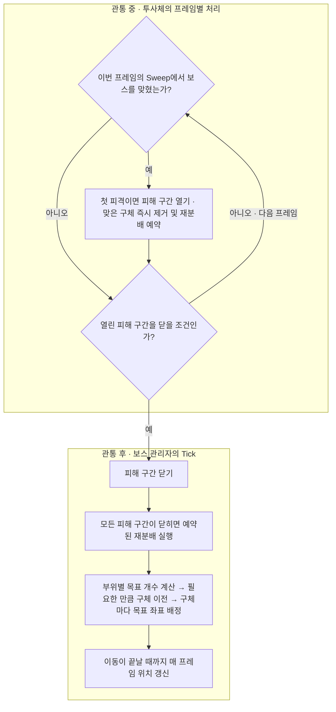

# 피격과 재구성

투사체가 군체 보스를 관통하면 경로에 있던 구체가 즉시 사라집니다. 관통이 끝나면 보스 관리자는 살아남은 구체를 각 부위에 몇 개씩 배치할지 다시 계산합니다. 부족한 부위에 구체를 보내고, 각 구체에 새 목표 위치를 배정해 거인의 형상을 재구성합니다.

## 맞은 구체를 찾아 즉시 제거하기

투사체는 매 프레임 이동 경로를 따라 자기 크기의 구를 쓸어 보며 충돌을 찾습니다(`SweepMultiByObjectType()`). 충돌 결과는 경로에 닿은 순서로 정렬합니다. 벽이나 바닥에 닿기 전에 같은 보스의 팔과 몸통을 맞혔다면, 그 프레임의 두 부위 피격 결과를 한 묶음으로 보스 관리자에 전달합니다. [`ASwarmProjectile::Advance()`](../Source/SwarmBoss/Projectiles/SwarmProjectile.cpp#L59)

보스는 부위마다 `Instanced Static Mesh`(ISM) 컴포넌트 하나로 구체를 그립니다. 피격 결과 `FHitResult`에서 `Hit.GetComponent()`는 맞은 부위의 ISM을, `Hit.Item`은 **Sweep 당시** 그 ISM에서 구체가 차지한 인스턴스 번호를 알려 줍니다. 보스 관리자는 `InstanceToParticle[Hit.Item]`으로 중앙 저장소의 구체 ID인 `ParticleId`를 찾습니다. 인스턴스 번호는 ISM 배열에서 구체를 지우면 바뀔 수 있고, 생존한 구체의 `ParticleId`는 그대로 유지됩니다. [`RemoveHitInstances()`](../Source/SwarmBoss/Boss/SwarmBossManager.cpp#L895)

ISM에서 구체 A를 교환 삭제하면, 마지막 칸에 있던 구체 B가 A가 쓰던 칸을 채웁니다.

| 구체 | 원래 위치 (ISM 번호) | A 삭제 후 |
| --- | --- | --- |
| A | `2`번 칸 | 삭제됨 |
| B | `7`번 칸 (마지막) | `2`번 칸으로 이동 |

보스 관리자가 부위 ISM의 `RemoveInstance(2)`를 호출하면, ISM이 A를 삭제하고 B를 `2`번 칸으로 옮깁니다. B의 화면 위치는 그대로입니다. 호출이 성공하면 관리자는 중앙 저장소의 A를 비활성으로 표시하고, `InstanceToParticle[2]`가 B의 ID를 가리키게 하며, B의 `InstanceIndex`도 `2`로 갱신합니다.

같은 Sweep에서 A와 B가 모두 맞았다면, 피격 결과의 Hit.Item에는 당시 인스턴스 번호인 `2`와 `7`이 들어 있습니다. `RemoveHitInstances()`는 첫 삭제 전에 `InstanceToParticle`로 각 번호에 해당하는 `ParticleId`를 찾아 함수 내부의 임시 배열 `HitParticleIds`에 모아 둡니다. A를 지운 뒤 B의 인스턴스 번호가 `7`에서 `2`로 바뀌어도, 배열에 저장해 둔 B의 `ParticleId`로 중앙 저장소에서 현재 번호 `2`를 찾아 B를 삭제할 수 있습니다.

## 관통이 끝날 때까지 손실 모으기

한 발이 보스를 통과하는 동안 여러 프레임에 걸쳐 구체가 사라질 수 있습니다. 투사체는 보스를 처음 맞힌 프레임에 `BeginDamageWindow()`를 호출합니다. 이때부터 보스 관리자는 손실을 즉시 반영하면서도 자동 재분배는 미룹니다. 구체를 제거할 때 자동 재분배가 켜져 있으면 `bRebalancePending`을 설정해 둡니다.

투사체가 **이번 프레임에 보스를 맞히지 않았고**, 프레임 끝의 투사체 중심이 **투사체 반지름만큼 확장한 보스의 경계 상자 밖**에 있으면 `EndDamageWindow()`를 호출합니다. 따라서 팔과 몸통 사이의 틈에서 잠깐 피격이 끊겨도 상자 안에 있으면 기다립니다. 투사체가 벽에 닿거나 수명이 끝나 사라질 때도 열린 구간을 닫습니다. [`ASwarmProjectile::Advance()`](../Source/SwarmBoss/Projectiles/SwarmProjectile.cpp#L59)

관리자의 `Tick()`은 `bRebalancePending`이 설정되어 있고 `OpenDamageWindowCount`가 `0`이면 `RebalancePartsFromDefinition()`을 호출합니다. 여러 발이 연달아 맞아 피해 구간이 겹쳤다면 마지막 구간이 닫힌 뒤 한 번 처리합니다. 이 시점의 생존 수로 목표를 계산하므로, 관통 도중 새 손실이 생길 때마다 목표가 다시 바뀌는 일을 피합니다. [`ASwarmBossManager::Tick()`](../Source/SwarmBoss/Boss/SwarmBossManager.cpp#L1550)

## 부위 사이에서 몇 개를 옮길지 결정하기

`RebalancePartsFromDefinition()`은 각 부위에 남은 구체 수를 합산한 뒤, 초기 형상 생성과 같은 가중치로 부위별 목표 개수를 계산합니다. 각 몫의 소수점 아래를 버리고 남은 구체 수는 `RemainderPartId`로 지정한 부위에 더합니다. [`RebalancePartsFromDefinition()`](../Source/SwarmBoss/Boss/SwarmBossManager.cpp#L1440)

몸통과 팔만 있고 가중치가 2:1이라고 가정해 봅시다. 피격 전에는 몸통 60개, 팔 30개였습니다. 팔에서 9개가 사라지면 현재 개수는 몸통 60개, 팔 21개입니다. 전체 생존 수 81개를 2:1로 나눈 목표는 몸통 54개, 팔 27개이므로 몸통에서 팔로 6개를 보냅니다.

`FSwarmTransferPlanner`는 각 부위의 `현재 개수 − 목표 개수`를 부모·자식 연결을 따라 말단부터 합산합니다. 예를 들어 팔은 2개, 팔에 연결된 손은 4개가 부족하다면, 몸통과 팔 사이에는 합계 6개가 들어와야 하고 팔과 손 사이에는 그중 4개가 흘러야 합니다. 이 계산으로 관리자는 어느 부위에서 어느 부위로 몇 개를 보낼지 알 수 있습니다. [`FSwarmTransferPlanner::Plan()`](../Source/SwarmBoss/Boss/SwarmTransferPlanner.cpp#L12)

보스 관리자는 출발 부위에서 다음 부위와의 연결점에 가까운 구체부터 고릅니다. 거리는 구체의 현재 월드 위치와 두 부위 연결점의 중간 지점 사이에서 비교합니다. 예를 들어 몸통에서 손으로 구체를 보낼 때는 몸통 소속 구체 중 팔과 맞닿는 관절에 가까운 구체를 골라 손의 ISM으로 넘깁니다. 구체는 이후 손의 목표 좌표를 향해 움직입니다. [`RebalanceToCounts()`](../Source/SwarmBoss/Boss/SwarmBossManager.cpp#L1175)

## 각 구체가 어디로 갈지 정하기

목표 개수는 팔에 구체가 몇 개 필요한지 알려 줍니다. 그 구체들이 팔 안에서 차지할 자리와 각 자리로 갈 구체는 `RebalanceToCounts()`에서 다음 순서로 정합니다.

1. **목표 좌표 생성.** 구체를 옮기기 전에 현재 개수와 목표 개수가 다른 부위를 샘플링해, 새 도형 크기와 목표 좌표를 구합니다. 목표 좌표는 해당 부위의 ISM 컴포넌트 기준 로컬 좌표입니다. [군체 형상 생성](SwarmGeneration.md)
2. **부위 다시 배치.** `ApplyPartPlacement()`는 새 도형 크기로 부모와 자식 부위의 연결점 위치를 계산하고, 연결점에 맞춰 자식 ISM의 위치와 회전을 갱신합니다. 각 구체의 현재 월드 위치를 유지하도록 같은 부위 안에서 로컬 좌표를 다시 계산합니다.
3. **구체 소속 변경.** 관리자는 전달 계획에 따라 보낼 구체를 고르고, `TransferParticle()`로 출발 부위의 ISM에서 도착 부위의 ISM으로 옮깁니다. 이때 `ParticleId`는 유지하고 소속 부위와 인스턴스 번호를 갱신합니다. 예를 들어 몸통에서 팔로 넘긴 구체는 몸통에 있던 마지막 위치를 팔의 ISM 기준 로컬 좌표로 바꿔 저장합니다.
4. **목표 배정.** 소속 변경을 마친 뒤, 관리자는 기존 구체와 새로 들어온 구체를 함께 고려해 부위 안의 목표 좌표와 일대일로 짝짓습니다. 들어온 수와 나간 수가 같아도 구성원이 바뀐 부위는 목표 좌표를 다시 생성해 배정합니다. 개수가 이미 목표와 일치하고 구성원도 그대로인 부위는 기존 목표를 유지합니다.

샘플러가 목표 좌표의 개수를 맞춰도, 구체와 목표를 배열 순으로 짝지으면 가까운 빈자리를 두고 부위 반대편까지 이동할 수 있습니다. `FSwarmTargetAssigner`는 각 구체의 가까운 목표 후보를 찾고, 전체 후보 쌍을 거리순으로 훑으며 구체와 목표가 모두 배정되지 않은 쌍을 먼저 확정합니다. 후보를 모두 놓친 구체는 남은 목표 중 가장 가까운 곳을 받습니다. 기존 구체는 현재 위치 주변에서 목표 후보를 찾습니다. 다른 부위에서 들어온 구체가 아직 도착 부위 밖에 있으면, 도착 부위의 표면에서 구체와 가장 가까운 곳을 고른 뒤 그 주변에서 목표 후보를 찾습니다. [`FSwarmTargetAssigner::Assign()`](../Source/SwarmBoss/Swarm/SwarmTargetAssigner.cpp#L310)

가까운 쌍부터 배정하다 보면, 먼저 배정받은 구체들이 가까운 자리를 차지해 마지막 구체에 먼 목표만 남을 수 있습니다. 이때 여러 구체의 목표를 도미노처럼 하나씩 바꿔 긴 이동을 줄입니다. 아래는 한 부위의 목표 좌표를 한 축으로 단순화한 예시입니다. 목표는 `0`, `10`, `20`입니다. 가까운 쌍부터 배정하면 A가 `10`, B가 `20`을 받습니다. C도 `20` 근처에 있지만, 이제 빈 목표는 `0`뿐입니다.

| 구체 | 출발 위치 | 처음 받은 목표 (이동 거리) | 바꾼 목표 (이동 거리) |
| --- | ---: | --- | --- |
| A | `9` | `10` (1) | `0` (9) |
| B | `19` | `20` (1) | `10` (9) |
| C | `22` | `0` (**22**) | `20` (**2**) |

이 예시에서 이동 거리 기준을 `10`으로 두면, C에 B의 목표 `20`을 주고 B에 A의 목표 `10`을 준 뒤 A에 `0`을 줄 수 있습니다. 가장 긴 이동은 `22`에서 `9`로 줄어듭니다. 실제 구현은 기준을 넘는 배정을 잠시 풀고, 각 구체가 기준 거리 안에서 갈 수 있는 목표만 따라가며 빈 목표까지 이어지는 순서를 너비 우선 탐색으로 찾습니다. 탐색 한도 안에서 순서를 찾지 못하면 기존 배정을 유지합니다. 이동 중 구체들의 경로는 겹칠 수 있습니다. [`RepairLongMoves()`](../Source/SwarmBoss/Swarm/SwarmTargetAssigner.cpp#L175)

## 목표까지 이동시키기

목표 배정이 끝나면 보스 관리자는 매 프레임 `UpdateParticleMovement()`를 호출해 구체를 목표 위치에 조금씩 가까이 보냅니다. 다른 부위에서 몸통으로 넘어온 구체는 원래 있던 자리에서 몸통 안의 목표까지 움직입니다. 보간에 쓰는 현재 위치와 목표 위치는 모두 몸통의 ISM 기준 로컬 좌표입니다.

구체는 처음에 빠르게 움직이고, 목표에 가까워질수록 느려집니다. 이동 거리가 달라도 `ReconstructionDuration`이 지나면 각자 목표에 도착합니다. 시연에서는 몸통에 맞은 구체가 사라지고, 남은 구체가 새 목표 위치로 이동합니다. 재구성 과정에서 관리자는 줄어든 구체 수에 맞춰 부위별 도형 크기와 목표 위치를 다시 계산합니다. [`UpdateParticleMovement()`](../Source/SwarmBoss/Boss/SwarmBossManager.cpp#L1701)