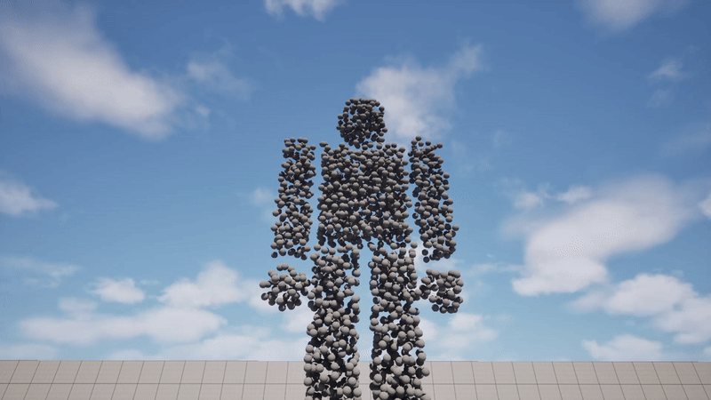

# 군체 보스

Unreal Engine 5.7과 C++로 개발 중인 군체 보스 기술 데모입니다. 개별 구체들이 모여 거인 하나를 이룹니다. 투사체가 군체를 관통하면 경로에 있던 구체들이 사라집니다. 남은 구체들은 부위 사이를 이동해 빈자리를 채우고, 거인은 원래의 비율을 유지하며 작아집니다.

향후에는 거인을 구성하는 구체들이 재배치되어 여러 자루의 검으로 변하는 기능을 추가할 계획입니다.

## 시연

[시연 영상](https://youtu.be/WgvwN_u2ToU)

## 개발 환경 및 기술

| 구분 | 사용 기술 |
| --- | --- |
| 엔진·언어 | Unreal Engine 5.7, C++ |
| 렌더링 | Instanced Static Mesh (ISM) |
| 형상 정의 | Data Asset |
| 구체 배치 | 3D Poisson Disk Sampling |

## 핵심 시스템

### [군체 형상 생성](Docs/SwarmGeneration.md)

구체를 부위별 가중치에 따라 나누고, 각 도형 안에 최소 간격을 지켜 배치한 뒤 연결점에 맞춰 거인을 조립합니다.

### [피격과 재구성](Docs/HitAndReconstruction.md)

맞은 구체는 즉시 제거하고, 한 발의 관통이 끝나면 손실을 모아 한 번 재분배합니다. 관절 가까이의 구체를 부족한 부위로 보내고, 배정 후에도 긴 이동이 남으면 여러 구체의 목표를 바꿔 이동 거리를 줄입니다.

### [프로파일링](Docs/Profiling.md)

Unreal Insights로 재분배 비용을 분석했습니다. 재구성 샘플링의 후보 시도 한도를 30회에서 15회로 낮추고, 투사체 Sweep에 필요한 충돌 조회를 유지하면서 부위 ISM의 겹침 이벤트를 껐습니다. 재분배 전체 시간의 중앙값은 초기 61.61ms에서 최신 37.71ms로 줄었습니다. 
다음으로는 초기 배치에서 만든 구체 위치를 재사용하려고 합니다. 부위가 작아지면 새 도형 안에 들어오는 기존 위치를 골라 쓰고, 필요한 개수를 채울 수 없을 때만 그 부위를 다시 샘플링할 계획입니다.

## 대표 소스 위치

| 영역 | 주요 소스 |
| --- | --- |
| 피격 처리 | [SwarmProjectile.cpp](Source/SwarmBoss/Projectiles/SwarmProjectile.cpp), [SwarmParticleStore.cpp](Source/SwarmBoss/Swarm/SwarmParticleStore.cpp) |
| 재구성 및 목표 배정 | [SwarmBossManager.cpp](Source/SwarmBoss/Boss/SwarmBossManager.cpp), [SwarmTransferPlanner.cpp](Source/SwarmBoss/Boss/SwarmTransferPlanner.cpp), [SwarmTargetAssigner.cpp](Source/SwarmBoss/Swarm/SwarmTargetAssigner.cpp) |
| 형상 정의와 배치 | [SwarmFormDefinition.h](Source/SwarmBoss/Boss/SwarmFormDefinition.h), [SwarmShapeSampler.cpp](Source/SwarmBoss/Swarm/SwarmShapeSampler.cpp) |
